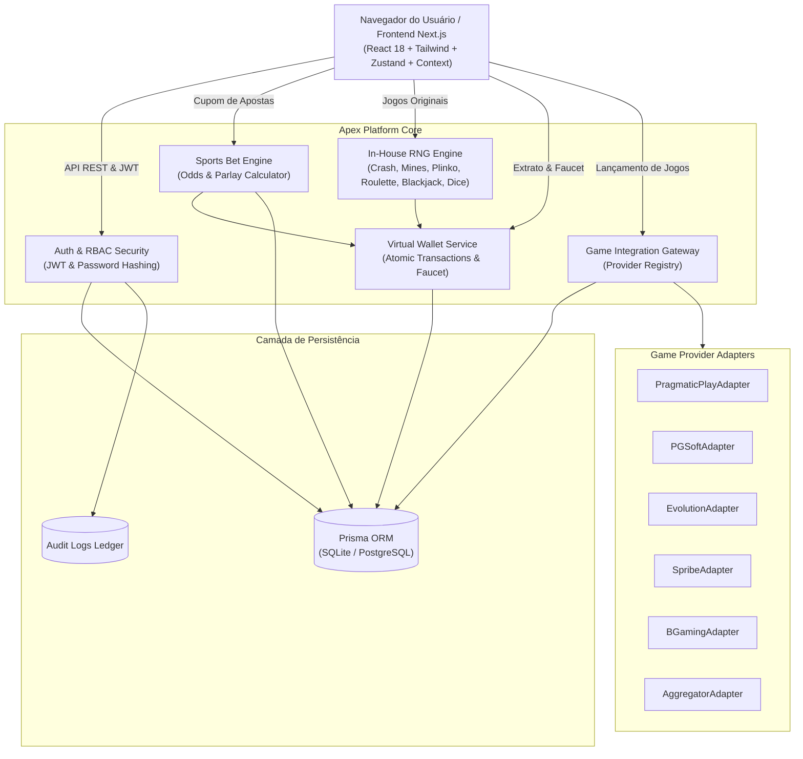
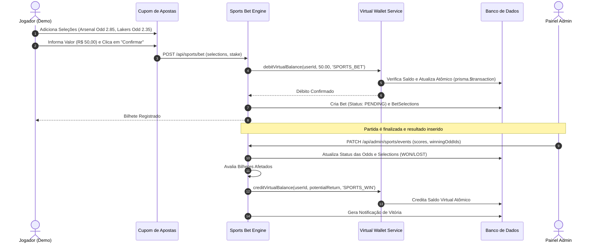

# Arquitetura do Sistema — Apex Bet & Casino

## 1. Visão Arquitetural

---

## 2. Diagrama de Sequência: Apostas Esportivas e Liquidação

---

## 3. Entidades do Banco de Dados (Prisma Schema)

- **Contas & Autenticação:** `User`, `Session`, `ComplianceSettings`
- **Carteira Virtual:** `Wallet`, `WalletTransaction` (Ledger atômico com saldo antes/depois)
- **Provedores & Catálogo:** `Provider`, `ProviderCredentials`, `ProviderIntegration`, `ProviderSyncLog`, `GameCategory`, `Game`, `GameSession`, `DemoGameRound`
- **Apostas Esportivas:** `Sport`, `Competition`, `SportEvent`, `Market`, `Odd`, `Bet`, `BetSelection`
- **Suporte & Auditoria:** `SupportTicket`, `TicketMessage`, `Notification`, `AuditLog`, `SystemSettings`
