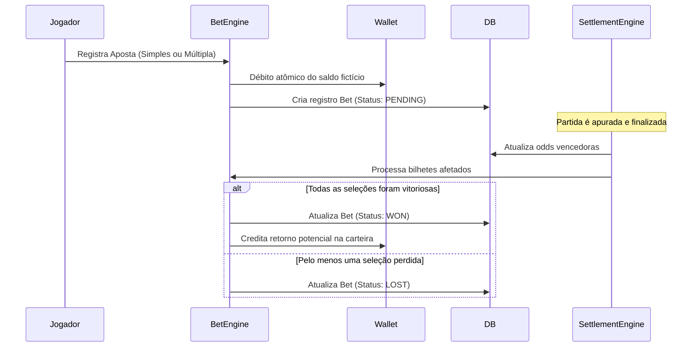

# Guia de Integração com APIs de Dados Esportivos

Este documento orienta a configuração e integração de feeds de dados esportivos oficiais com o **Apex Sports Bet Engine**.

---

## 1. Arquitetura do Adaptador Esportivo

O sistema separa com precisão os 4 produtos fundamentais de dados esportivos:
1. **Calendário e Confrontos (Fixtures):** Datas, estádios, equipes e status da partida.
2. **Placares e Eventos Ao Vivo (Live Scores & Clock):** Minuto de jogo, gols, cartões, faltas e posse de bola.
3. **Cotações Licenciadas (Odds Feeds):** Mercados 1X2, Over/Under, Ambas Marcam e Handicap.
4. **Liquidação e Resultados Oficiais (Settlement Feeds):** Confirmação auditada do resultado final para apuração de apostas.

---

## 2. Provedores Suportados

### 2.1 The Odds API
- **Ideal para:** Cotações dinâmicas pré-jogo e ao vivo de mais de 40 casas internacionais.
- **Endpoint:** `https://api.the-odds-api.com/v4/sports/{sport}/odds`
- **Configuração no `.env`:**
  ```env
  SPORTS_DATA_PROVIDER="THE_ODDS_API"
  SPORTS_DATA_API_KEY="sua_chave_the_odds_api"
  ```

### 2.2 API-Football
- **Ideal para:** Placares em tempo real, cronômetro, escalações e estatísticas de posse de bola.
- **Endpoint:** `https://v3.football.api-sports.io`
- **Headers:** `x-apisports-key: <sua_api_key>`

### 2.3 Feed Local Simulado (Default Out-of-the-Box)
- Quando não há credenciais externas preenchidas, o motor executa com o feed demonstrativo de alta fidelidade:
  - Partidas ao vivo (Premier League, Champions League, Brasileirão, NBA, UFC, CS2).
  - Cronômetro decorrido e placares simulados.
  - Odds calculadas de acordo com margem de retorno de 95% do mercado.
  - Zero dependência externa para testes locais 100% offline.

---

## 3. Ciclo de Vida de uma Aposta Esportiva


